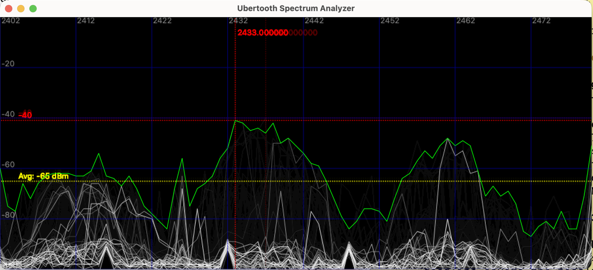
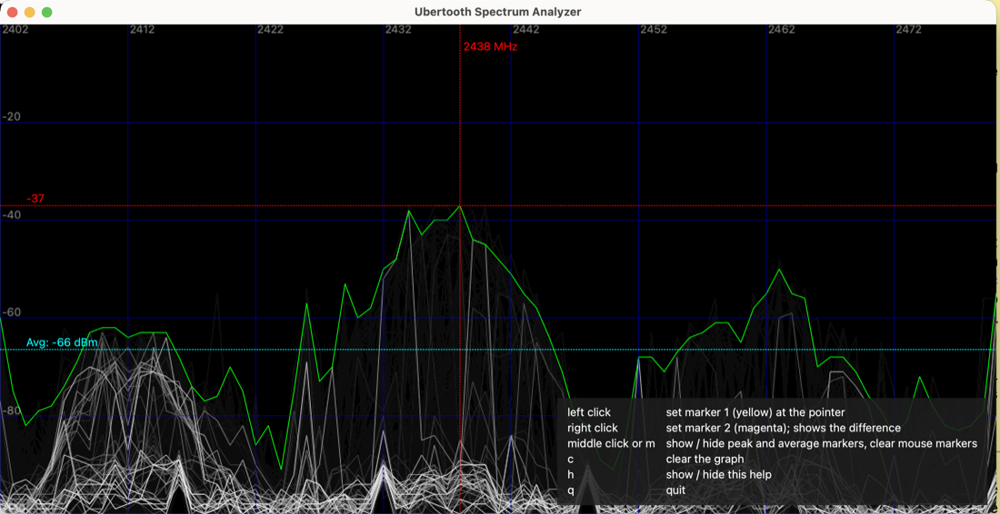

==================================
Spectrum analyzer UI (specan_ui)
==================================

``ubertooth-specan-ui`` is a graphical real-time spectrum analyzer for the
Ubertooth. It is a Python/Qt application that reads spectrum data from the
device (via ``ubertooth-specan``) and plots it.

         line, and both mouse markers with their frequency differences

This guide covers installing and running it, its options, keys and display,
and the common ``ModuleNotFoundError: No module named 'specan'`` error. The
same reference is in the ``ubertooth-specan-ui(1)`` man page.

Requirements
~~~~~~~~~~~~

- Python 3.8 or newer. Every feature works on 3.8. On an older interpreter
  the build skips the Python tools with a warning (or fails with
  ``-DREQUIRE_ALL=ON``).
- Python packages: ``numpy``, ``qtpy``, and one Qt binding, **PySide6** or
  **PyQt5**. The Python version only limits which binding release you can
  install:

  - pip: ``pip install numpy qtpy pyside6`` picks a PySide6 release that
    supports your Python (6.6 on Python 3.8).
  - Debian/Ubuntu apt: ``python3-numpy python3-qtpy python3-pyqt5``. Ubuntu
    has no ``python3-pyside6`` package before 24.10.
- The built Ubertooth host tools (so ``ubertooth-specan`` is available).

Install
~~~~~~~

``ubertooth-specan-ui`` has two parts: the launcher script (installed to your
``bin`` directory) and the ``specan`` Python package (which the launcher
imports). **Both** are installed when you install the host tools:

.. code-block:: sh

   cd host/build
   cmake ..
   make
   sudo make install          # installs the launcher AND the specan package

The install step uses native CMake file installation for the pure-Python
``specan`` package; it does not run ``setup.py install`` or modify Python
outside ``CMAKE_INSTALL_PREFIX``. The installed launcher locates the package
relative to itself, so custom prefixes and ``DESTDIR`` staging work without
setting ``PYTHONPATH``.

Run
~~~

.. code-block:: sh

   ubertooth-specan-ui

On Linux you may need ``sudo`` (or udev rules) for device access:

.. code-block:: sh

   sudo ubertooth-specan-ui

With ``install.sh --venv``, the Python packages are in that venv; the installed
launcher already uses it.

Options
~~~~~~~

- ``-U <index|serial>`` — select one of several Ubertooths, by USB enumeration
  index or serial number (``ubertooth-util -s`` lists them).
- ``-l <MHz>`` / ``-u <MHz>`` — lower and upper frequency, 2402-2480 MHz
  (default: the whole band). The plot is drawn 2 MHz wider than the scanned
  range on each side (2400-2482 MHz by default).
- ``--wifi[=<channel(s)>]`` — show the band around one Wi-Fi channel
  (``--wifi=6``) or a range (``--wifi=1-11``).
- ``--padding <MHz>`` — extra band on each side with ``--wifi`` (default 10).

For example, to watch Wi-Fi channels 1 to 6 on the second Ubertooth:

.. code-block:: sh

   ubertooth-specan-ui -U 1 --wifi=1-6

Keys and mouse
~~~~~~~~~~~~~~

Press ``h`` in the window to show this list on screen (a small ``h: keys``
hint is always shown in the corner). Keys work in upper or lower case.

There are two mouse markers, one per button; clicking again moves that marker.
With both set, the frequency differences between them and to the peak are
shown. On a Mac trackpad, right click is a two-finger click or Control-click.

==========================  ==================================================
Key / button                Action
==========================  ==================================================
left click                  Set marker 1 (yellow) at the pointer
right click                 Set marker 2 (magenta)
middle click or ``m``       Show or hide the peak and average markers, and
                            clear the mouse markers
``c``                       Clear the graph (also restarts the average)
``h``                       Show or hide the key help
``q``                       Quit
==========================  ==================================================

What the display shows
~~~~~~~~~~~~~~~~~~~~~~

- **White trace:** the current sweep; earlier sweeps fade out behind it.
- **Green trace:** the peak (max-hold) level per frequency over the most
  recent sweeps.
- **Red dotted lines:** the strongest peak, labelled with its frequency (MHz)
  and level (dBm).
- **Cyan dotted horizontal line, labelled "Avg: N dBm":** the average of the
  green max-hold trace across the band, smoothed so it moves slowly.
- **Yellow and magenta markers:** points marked with the left and right mouse
  buttons, with the frequency differences to the peak and to each other.

Troubleshooting ``ModuleNotFoundError: No module named 'specan'``
~~~~~~~~~~~~~~~~~~~~~~~~~~~~~~~~~~~~~~~~~~~~~~~~~~~~~~~~~~~~~~~~~~~

The launcher ran but its Python cannot import the ``specan`` package. If you
installed with ``install.sh`` this should not happen: it installs both parts
for the same Python (including with ``--venv``). Otherwise:

1. **Not installed.** Run ``sudo make install`` from ``host/build``, or for a
   quick test from the source tree:

   .. code-block:: sh

      PYTHONPATH=host/python/specan_ui ubertooth-specan-ui

2. **An old launcher runs first.** A launcher left by an earlier install (for
   example in ``/usr/local/bin``) may come earlier on ``PATH``. List them all
   and remove the stale one:

   .. code-block:: sh

      which -a ubertooth-specan-ui

If the UI starts but cannot reach the device, that is a permissions/udev issue,
not this error — see the getting-started / udev documentation.
